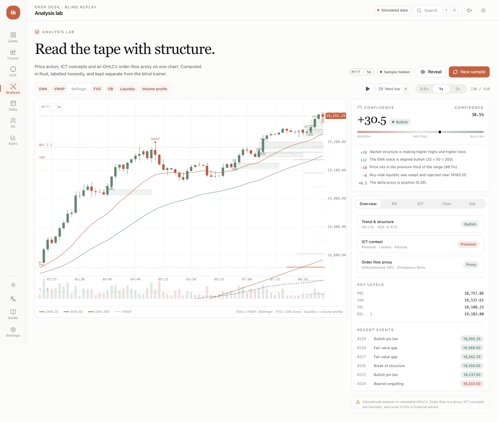

# Prop Desk

A blind-replay trading trainer for prop-firm instruments. Prices, symbol and date are hidden while candles print
one at a time. You size like a futures trader, place bracketed orders, and manage risk against real evaluation
guardrails: profit target, trailing drawdown, daily loss limit.

The decision drill then grades the part most traders skip — state, an optional thesis, and a plan whose stop
belongs beyond structure rather than at your comfort level.

> **Simulated by default.** Every series is generated deterministically from a seeded regime model. Optionally,
> you can drop in a local pack of real 5-minute futures bars (`bun run data:fetch`) and practice on that instead.
> There is no live market feed, no broker connection, and nothing in this app is financial advice.




## Features

- **Blind replay trainer** — hidden instrument, date and price axis; candle-by-candle playback, market/limit
  orders, brackets, futures P&L in ticks, commissions, and prop-firm guardrails.
- **Decision drill** — read the state, add an optional thesis, drag entry/stop/target on the chart, size by risk,
  then receive a process grade split into state (40), direction (20), plan structure (25) and discipline (15).
- **Fills on review** — after the reveal, the chart marks every actual fill (entry triangle, exit diamond) with
  price and UTC candle time, and a Locate button frames the trade. Fills are never drawn while the tape is blind.
- **Daily challenge** — one sample seeded by the UTC date, with deterministic _reference plans_ as a benchmark
  board. First submission is locked; replays cannot overwrite it.
- **Friends PK** — local pass-and-play on the same seed, one committed attempt per player, process score wins
  and R breaks ties. Results stay in the browser, by design.
- **Analysis lab** — price action, ICT concepts and an OHLCV order-flow proxy on one chart: EMA/VWAP/Bollinger,
  market structure (BOS/CHoCH), FVG and order blocks, liquidity levels/sweeps, volume profile, delta pressure and
  a weighted confluence score. All computed in Rust/WASM.
- **Optional exam helpers** — the chart toolbar's TA toggle enables the same visible-bar analysis in training
  and drill questions, including daily/PK attempts. PA, ICT, flow proxy and indicators switch independently;
  helpers start off, keep blind price/date masking, and do not change the grading rules.
- **Optional real data** — fetch a local 5-minute pack from Yahoo Finance, switch sources in Settings, and train
  on real CME micro/mini futures tape without giving up the blind contract. Daily and PK stay generated.
- **Replay terminal** — a free-form Tradovate-style desk on the same historical tape: market/limit/stop/stop-limit/
  trailing entries with DAY/GTC/GTD and release times, one stop plus up to five OCO targets, break-even and
  trailing ATM, chart drag-to-replace and click-to-price, up to three linked chart panes with a saved layout, a
  price ladder without fake depth, watchlist quotes, positions/orders/fills/history docks, and a prop account with
  drawdown floor, daily loss, contract cap, consistency and a conditional breach price. Every timeframe is
  aggregated from one 5-minute tape, and the attempt (clock, positions, orders) is restored from IndexedDB after a
  refresh.
- **Stats** — equity curve, R distribution, instrument edge, process metrics and session history.
- **English-first i18n** — complete `en`, `zh-CN` and `ja` bundles (key parity checked).
- **Claude Design System port** — warm surfaces, clay accent, hairline rings, spring easing, light/dark themes,
  reduced-motion support, and a custom canvas chart.

## Stack

| Layer      | Choice                                                                                                |
| ---------- | ----------------------------------------------------------------------------------------------------- |
| App        | Nuxt 4, Vue 3, TypeScript (strict, `noUncheckedIndexedAccess`)                                        |
| Styling    | Tailwind CSS v4 with CDS tokens ported from [open-claude-ui](https://github.com/Caho1/open-claude-ui) |
| Primitives | Reka UI wrapped shadcn-style; `class-variance-authority` + `tailwind-merge`                           |
| State      | Pinia setup stores                                                                                    |
| i18n       | `@nuxtjs/i18n` (no prefix, cookie-aware SSR)                                                          |
| Charts     | Custom Canvas 2D engine (candles/OHLC/line/Heikin-Ashi, drawings, order lines, blind mode)            |
| Compute    | Rust → WebAssembly core for O(n) market, drill and analysis math, with a TypeScript fallback          |
| Tests      | Vitest unit/component tests including Rust/TypeScript parity, data races and chart invariants         |
| QA         | Playwright screenshot script                                                                          |

## Getting started

```bash
bun install
bun run dev        # http://localhost:3000
```

```bash
bun run test        # unit tests (runs through the real wasm core)
bun run typecheck   # vue-tsc
bun run build       # production build
bun run preview     # preview the production build
bun run data:fetch  # optional: fetch a local real-data pack (Yahoo Finance, gitignored)
bun run screenshot  # visual QA at 1440 and 390 (requires the dev server)
bun run smoke       # end-to-end flows against a running dev server
```

Bun 1.3+ is the package manager. The committed `public/wasm/prop_core.wasm` means Rust is **not** required to run the app.
To rebuild the core you need Rust with the `wasm32-unknown-unknown` target:

```bash
rustup target add wasm32-unknown-unknown
bun run wasm:build
```

The build writes a content hash to `app/wasm/artifact.ts`; the browser fetches `prop_core.wasm?v=<hash>` so a new
artifact is never served from cache. Restart the dev server (SSR loads the module at boot) and reload the page after
a rebuild.

Performance work is measured, not guessed:

```bash
bun run bench:wasm     # size, brotli/gzip, compile, generate/analyze/simulate
bun run measure:wasm   # real browser timings against a running server
bun run check:wasm     # proves the core never blocks first paint and loads once
bun run check:executions # result-page fill markers, same-bar exits and blind masking
bun run check:analysis   # exam overlay toggles, keyboard isolation, failure recovery and layout
bun run check:terminal   # replay terminal orders, chart trading, prop lines and mobile layout
bun run bench:timeframes # 13k-bar aggregation parity and P95 against the 10 ms budget
```

Current artifact: **157.6 KiB raw / 58.8 KiB brotli** (budget 160/60), including the replay aggregator. WASM never gates hydration: it warms on idle;
only a direct, server-rendered analysis visit adds a preload. SPA navigation shares the loader's pending request.
See [`docs/perf/wasm.md`](docs/perf/wasm.md) for the artifact history and
[`docs/perf/response.md`](docs/perf/response.md) for production response budgets, raw before/after samples and limits.

```bash
bun run bench:compute --check  # 710-bar public wrappers, validation and cached windows
bun run bench:ui --check       # production localhost:4173, synthetic + installed local pack
```

## Routes

| Route       | Purpose                                                                          |
| ----------- | -------------------------------------------------------------------------------- |
| `/`         | Lobby: pitch, animated preview, universe picker, rules, daily entry, recent form |
| `/trainer`  | Blind session: read → plan → live bracket → review → next round                  |
| `/terminal` | Replay trading desk: orders, brackets/ATM, ladder, prop account, history         |
| `/analysis` | Analysis lab: indicators, PA, ICT, order-flow proxy, confluence                  |
| `/drill`    | Standalone decision drill (`?seed=` for a shared sample)                         |
| `/daily`    | Daily sample, lock state, result and reference board                             |
| `/pk`       | Pass-and-play room, shared seed, rematch                                         |
| `/stats`    | Equity, R distribution, instrument edge, process, history                        |
| `/settings` | Theme, motion, language, account rules, universe, playback, data                 |
| `/guide`    | Protocol, keyboard reference, glossary, disclaimer                               |

## Architecture

```
wasm/                     Rust compute core (crate: prop_core)
  src/lib.rs              scenario generation, swing detection, plan simulation, JSON ABI
app/
  domain/                 pure TypeScript, no Vue imports
    wasm/                 typed bridge + JSON ABI client for the Rust core
    instruments/          contract specs + registry factory
    market/               seeded PRNG, regime OHLC generator, scenario factory, daily seed
    trading/              broker, futures P&L, sizing, prop rules
    drill/                plan validation, conservative simulation, grading, reference plans
    stats/                trade analytics + persistence record types
    analysis/             analysis report types and the Rust-core entry point
    settings/             zod schema and defaults
    sim/                  replay calendar, timeframes, risk engine, order engine, presets
  lib/
    chart/                canvas engine, geometry, theme reader
    sim/                  pinned replay tapes, session wrapper, IndexedDB checkpoints
    repositories/         history repository over a KeyValueStore
    storage.ts            storage adapter factory (localStorage / memory)
    audio.ts              Web Audio cue synth (no assets)
  components/             ui kit, layout shell, chart, terminal, trainer, lobby, drill, stats
  stores/                 Pinia orchestration (trainer, drill, terminal, settings, history, pk, toasts)
  pages/                  routes
i18n/locales/             en, zh-CN, ja
tests/unit/               domain and adapter tests
```

### Patterns

- **Factory + registry** — `createInstrumentRegistry`, `createScenarioFactory`, `createBroker`,
  `createHistoryRepository`, `createWebStore`. Adding a contract is one catalog entry; adding a data source is one
  adapter, not a refactor.
- **Domain stays pure** — the broker, generator, sizing and grading have no Vue or DOM dependencies. They are
  deterministic and directly unit-tested.
- **One writer per concern** — Pinia stores own lifecycle and persistence; components render and emit. The
  trainer store is the only place that advances bars and feeds the broker.
- **Conservative simulation** — if a bar touches both stop and target, the stop is assumed first; gaps fill at
  the open; commissions are split half on entry and half on exit. The review should not flatter the trader.
- **Honest boundaries** — daily/PK reference results are labelled as deterministic strategy baselines, not people.
  No fake testimonials, payouts or live-data claims. The terminal's ladder shows prices, never invented depth,
  and its breach price is labelled conditional on the other instruments staying flat.

### The trading model

- Contracts, not notional leverage. `riskPerContract = stopTicks × tickValue + roundTurnFee`.
- `contracts = floor(riskBudget / riskPerContract)`, capped by the account's max contracts.
- Prop rules: trailing drawdown from the equity high-water mark, daily loss limit, profit target, contract cap.
- R multiple includes commissions, so a scratch trade reads slightly negative.

### Rust / WebAssembly compute core

The batch work runs in Rust, compiled to a 150.3 KiB WASM module:

| Work                                                                 | Why it is in Rust                                                |
| -------------------------------------------------------------------- | ---------------------------------------------------------------- |
| Regime scenario generation (710 OHLCV bars + ATR/efficiency metrics) | Runs for every round, daily sample, PK rematch and lobby preview |
| Fractal swing detection                                              | Cached for the visible prefix; reused across plan edits          |
| Plan simulation (bracket fill, gaps, stop-first, MAE/MFE, R)         | 300-bar conservative walk for trainer reviews and drill grading  |
| Chart analysis (indicators, structure, ICT, flow)                    | Recomputed on every visible-bar step in the analysis lab         |

Both the Nuxt server and the browser load the **same** module: the server reads
`public/wasm/prop_core.wasm` at boot, while the client warms it without blocking hydration. A typed JSON ABI
(`app/domain/wasm/core.ts`) keeps the call surface small; irregular market tapes include explicit timestamps so
session/weekend gaps survive analysis. Generation, swings and plan simulation have tested TypeScript fallbacks.
The analysis lab requires WASM and shows an unavailable state if it cannot load. The active core is shown under
Settings → Compute core.

Stateful O(1) work (per-bar broker state, risk sizing, formatting), rendering and Vue orchestration stay in
TypeScript — moving them across the boundary would add latency and lose reactivity without reducing real CPU work.
Parity is enforced by tests that generate candles, find swings and simulate plans through both paths and require
deep equality.

### Theming

- **Both schemes are declared in light mode.** `color-scheme: light dark` plus a matching meta tag prevented
  Chrome's forced-dark inversion in the tested browser. The app's palette follows `html.dark`; the inline
  `color-scheme` is `dark` or `light dark`. In light mode, native controls can therefore follow the OS preference.
  This is not a guarantee against arbitrary dark-mode extensions.
- **One palette, two modes.** Surfaces, ink, clay and market colours are CSS custom properties; every component
  reads them, so nothing is hard-coded to a mode. The canvas chart reads the same tokens through
  `readChartTheme()` and repaints on theme change.
- **The toggle advertises the action, not the state.** A sun on a dark page means “switch to light”. Icons are
  CSS-driven, so server and client markup agree even when `theme: system` resolves after hydration.
- **Contrast is tested.** `tests/unit/theme-contrast.spec.ts` asserts WCAG AA (4.5:1) for body text, muted text,
  rails and every filled accent (`--on-clay`, `--on-bull`, `--on-bear`, `--on-danger`) in both modes.
  `bun run audit:theme` samples visible DOM text on four routes in both modes and flags contrast failures;
  it is not an exhaustive accessibility audit.

### Market data packs

`bun run data:fetch` pulls free 5-minute bars for `MNQ`, `MES`, `NQ`, `ES`, `MYM`, `M2K`, `MGC` and `MCL` from
Yahoo Finance into `public/data/market/` (gitignored). `Settings → Market data` switches the sample source for the
trainer, drill and analysis; daily and PK remain generated for reproducibility.

- The loader validates every column, rejects out-of-order or inconsistent OHLC bars, and falls back to simulated
  tape instead of plotting corruption.
- A round draws a seeded `150 warm-up + 260 hidden + 300 reveal` window and shifts prices by a tick-aligned
  constant to obscure absolute levels. Seed reproducibility requires the same pack and instrument universe.
- Packs are gitignored and served from the app's origin, not fetched from Yahoo at runtime. A production build
  copies installed packs from `public/` into its output, so remove them before any unauthorized deployment.
  Blind mode hides information in the UI; the full tape is accessible in browser memory, not secured against inspection.
  See [docs/data/market-data.md](docs/data/market-data.md) for the schema, provenance and limits.

### Performance notes

- **Nonblocking WASM with scoped fallbacks.** The client plugin starts the load on idle without blocking hydration;
  the trainer and lobby can run on TypeScript until the core lands. The analysis lab requires WASM, shows a
  skeleton while loading, and reports an unavailable state if loading fails.
- **One download, one compile.** `WebAssembly.compileStreaming` plus a module cache and an instance cache means a
  session fetches and compiles the artifact once, even across client-side navigation. SSR reuses one instance per
  process.
- **Cache-safe delivery.** The URL carries a content hash, `/wasm/**` is immutable for a year, and Nitro emits
  `.br`/`.gz` variants at build time.
- **Small payloads.** Analysis input is sent as numeric columns (67 KiB → 22 KiB) and the response only contains
  the indicator series the chart draws (91 KiB → 51 KiB).
- **Budgets in CI.** `tests/unit/wasm-budget.spec.ts` fails if the artifact exceeds 160 KiB raw / 60 KiB brotli,
  if compression ratio drops below 2×, if an export disappears, or if the cache-busting hash goes stale.

### Analysis lab and exam helpers

The lab remains the full research view: indicator series, market structure, ICT zones, an order-flow proxy, and a
confluence score with translated reason codes. Exam charts reuse its Rust report and shared `buildChartAnalysis`
adapter through `useExamAnalysis`, without displaying the confluence score or changing grading rules.

On trainer and drill question pages (including daily/PK attempts), **TA** in the chart toolbar toggles the helpers.
The adjacent settings button opens a desktop popover or a mobile bottom panel, so it does not reduce chart height.
PA, ICT, flow proxy and indicators have independent switches, plus EMA, VWAP, Bollinger, FVG, OB, levels/liquidity
and volume-profile layer controls. The master switch starts off on each page mount; choices stay only for that
page visit. Escape closes settings and returns keyboard focus; controls do not trigger exam shortcuts.

`useExamAnalysis` slices to `candles.slice(0, visibleCount)` before calling Rust: hidden future bars and retrospective
scenario metrics are not inputs. The current prefix is recalculated as bars advance, so historical annotations may
change as new structure is confirmed. Blind mode still masks absolute prices and dates. This is a display-level
training aid, not secure anti-cheat: the browser still holds the full replay tape.

Framework/layer toggles reuse the computed report while at least one framework is on; disabling all frameworks or
TA clears it and skips further analysis work. WASM loading or errors never block exam actions; unavailable helpers
offer Retry. On narrow screens chart annotation labels are suppressed while geometry remains visible.

Order flow is **OHLCV-derived**: candle close position weights volume into a delta proxy. There is no bid/ask or
footprint feed, and the UI says so. ICT concepts are heuristics (swing-based FVG, OB, liquidity), not vendor signals.

### Replay terminal

`/terminal` is a separate free-form desk: no grading, no hidden contract. It replays one 5-minute tape per
instrument, and every chart timeframe (`5m`, `15m`, `30m`, `1h`, `4h`, `1D`) is an aggregation of that same revealed
prefix, so switching timeframe cannot move the clock or reveal future bars. Higher-timeframe bars are computed in
Rust (`prop_aggregate`) with an identical TypeScript reducer as the fallback and parity oracle.

The chart area holds one to three panes that share the replay clock; the active pane drives the ticket, ladder and
position card, and the layout (symbol, timeframe, style) is saved locally. Panes are display-only: adding or closing
one never advances the cursor or changes the account.

Orders support market, limit, stop, stop-limit, trailing stop and trailing stop limit, with DAY/GTC/GTD and optional
release times, partial targets, one stop plus up to five OCO targets, break-even/trailing ATM, reduce-only, and
add/reduce/reverse/flatten. Fills are print-driven against the revealed bar: resting orders fill at the level or at a
gapped open, and when a bar spans both stop and target the stop is assumed first. The chart can drag a working order
to a new tick-rounded price and click a price into the ticket; the price ladder shows prices and your own working
orders only — there is no order-book depth or time-and-sales in a 5-minute OHLCV tape, and the UI states that.

The prop account tracks a drawdown floor (static, intraday-trailing or end-of-day trailing, on balance or equity),
daily loss, contract cap, minimum trading days and a consistency gate. The account bar shows equity, day P&L,
cushion and daily loss left; the chart draws floor, daily and conditional breach levels when they fall inside the
visible price window. A breach price assumes every other instrument stays flat, so it is labelled as conditional.

Replay state is checkpointed to IndexedDB (`propdesk-replay-v1`) together with the pinned tapes, so a refresh
restores the same clock, positions and orders; a checkpoint that no longer matches its run is refused instead of
silently resetting. Display preferences (`symbol`, `timeframe`) live in `localStorage`. Nothing is sent to a broker.

### Chart engine

`ChartEngine` is a small retained-mode renderer: it owns viewport math, price scales, candles, volume, overlay
lines, drawings (trend/horizontal/Fibonacci), crosshair and pointer interaction. Review charts can also draw filled
entries and exits, with price/time labels, a dashed fill-to-fill connector and `focusRange()` framing. It renders
axes outside the plot clip, animates the newest candle, and supports a blind mode that masks prices, hides fills and
replaces timestamps with relative bars. Mobile layouts size the canvas absolutely to avoid a resize feedback loop.
On review, plan-level tags are suppressed while their lines stay visible, so they do not collide with fill labels.

### i18n

English is the source (`en.json`). `zh-CN` and `ja` mirror its keys; a parity check is part of the
translation workflow. Locale preference is stored in a cookie as well as localStorage so SSR and hydration agree.
The last chosen locale is applied before the first render.

### Visual system

Tokens are adapted from the Claude Design System via `open-claude-ui`: AA-adjusted clay, surface steps, hairline
rings, dual-ring overlays, 7-stop non-linear scroll fades, and a spring easing set. The full design rationale and
acceptance checklist live in [`docs/design/ui-spec.md`](docs/design/ui-spec.md).

## Keyboard

| Key             | Action                                              |
| --------------- | --------------------------------------------------- |
| `Space`         | Wait one bar while reading / play-pause live replay |
| `N`             | Advance exactly one bar                             |
| `1`–`4`         | State: uptrend, downtrend, range, disorder          |
| `L` / `S`       | Direction: long / short                             |
| `⌘K` / `Ctrl K` | Command palette                                     |
| `Esc`           | Close a dialog or the palette                       |

## Testing

The unit and component suites cover:

- instrument economics and registry validation,
- PRNG determinism and OHLC/tick invariants across all eight contracts,
- broker fills, gaps, brackets, fees, MAE/MFE, prop-rule breaches and target completion,
- risk sizing and the 1R definition,
- drill validation, conservative simulation and grading,
- daily seed determinism, reference plans and key parity-ready i18n bundles,
- trade analytics, history repository round-trips, and settings schema fallbacks,
- analysis report shape, profile/POC bounds, FVG/OB geometry and event ordering,
- exam helper visible-prefix isolation, framework/layer gates, cached reports and WASM failure/retry handling,
- compact analysis controls, localized summaries, keyboard isolation and focus return,
- exact Rust ↔ TypeScript parity for candles, metrics, swings and plan outcomes,
- local pack cache generations, refresh races, negative-cache recovery and future-independent rebasing,
- shallow scenario state, newest-start-wins, visible-swing reuse, decision-time grading and session accounting,
- fill normalization across session gaps, same-bar round trips, no-fill plans and invalid bar coordinates,
- replay session no-lookahead/determinism/restore, session rolls and corrupt checkpoints,
- order lifecycle across all six order types, TIF/release, partial targets, OCO and ATM,
- prop drawdown modes, daily loss actions, consistency boundaries and breach-price rounding,
- timeframe aggregation parity (TS ↔ WASM), DST session opens and out-of-session bar filtering,
- pre-paint chart geometry, no-op redraws, reveal animation targets, option updates and reduced motion.

Visual QA: `bun run screenshot` writes desktop and mobile captures to `screenshots/` (git-ignored).

## Limitations

- No server, accounts, or cross-device sync. History and PK rooms are local.
- If WASM is blocked, generation and trading simulation fall back to TypeScript; the analysis lab and exam
  analysis helpers are unavailable. Exam actions still work. Settings shows the active compute status.
- Scenarios are synthetic by default, or sampled from an optional local pack; neither proves a real trading edge.
- One open position and one working order per account, intentionally, to keep the decision surface honest.
- Reference plans are fixed strategy baselines; they are not a ranking of real traders.

## License

MIT. Design-token inspiration: [open-claude-ui](https://github.com/Caho1/open-claude-ui) (MIT).
