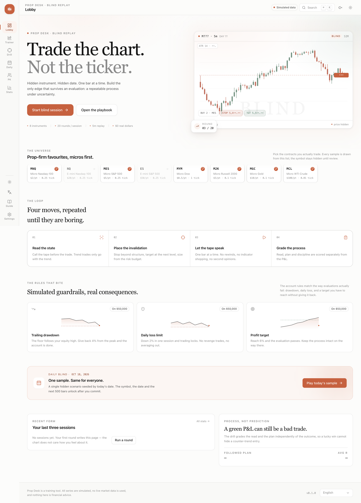
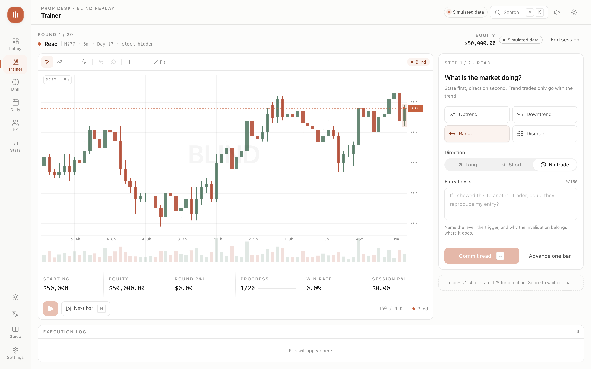

# Prop Desk

A blind-replay trading trainer for prop-firm instruments. Prices, symbol and date are hidden while candles print
one at a time. You size like a futures trader, place bracketed orders, and manage risk against real evaluation
guardrails: profit target, trailing drawdown, daily loss limit.

The decision drill then grades the part most traders skip — state, thesis, and a plan whose stop belongs beyond
structure rather than at your comfort level.

> **Simulated data.** Every series is generated deterministically from a seeded regime model. There is no live
> market feed, no broker connection, and nothing in this app is financial advice.





## Features

- **Blind replay trainer** — hidden instrument, date and price axis; candle-by-candle playback, market/limit
  orders, brackets, futures P&L in ticks, commissions, and prop-firm guardrails.
- **Decision drill** — read the state, commit a thesis, drag entry/stop/target on the chart, size by risk, then
  receive a process grade split into state (40), direction (20), plan structure (25) and discipline (15).
- **Daily challenge** — one sample seeded by the UTC date, with deterministic _reference plans_ as a benchmark
  board. First submission is locked; replays cannot overwrite it.
- **Friends PK** — local pass-and-play on the same seed, one committed attempt per player, process score wins
  and R breaks ties. Results stay in the browser, by design.
- **Stats** — equity curve, R distribution, instrument edge, process metrics and session history.
- **English-first i18n** — complete `en`, `zh-CN` and `ja` bundles (578 keys each, parity checked).
- **Claude Design System port** — warm surfaces, clay accent, hairline rings, spring easing, light/dark themes,
  reduced-motion support, and a custom canvas chart.

## Stack

| Layer      | Choice                                                                                                |
| ---------- | ----------------------------------------------------------------------------------------------------- |
| App        | Nuxt 4, Vue 3, TypeScript (strict, `noUncheckedIndexedAccess`)                                        |
| Styling    | Tailwind CSS v4 with CDS tokens ported from [open-claude-ui](https://github.com/Caho1/open-claude-ui) |
| Primitives | Reka UI wrapped shadcn-style; `class-variance-authority` + `tailwind-merge`                           |
| State      | Pinia setup stores                                                                                    |
| i18n       | `@nuxtjs/i18n` (no prefix, cookie-aware SSR)                                                          |
| Charts     | Custom Canvas 2D engine (scales, candles, drawings, blind mode)                                       |
| Compute    | Rust → WebAssembly core for O(n) market/drill math, with a TypeScript fallback                        |
| Tests      | Vitest, 92 tests including Rust/TypeScript parity                                                     |
| QA         | Playwright screenshot script                                                                          |

## Getting started

```bash
bun install
bun run dev        # http://localhost:3000
```

```bash
bun run test        # unit tests (runs through the real wasm core)
bun run typecheck   # vue-tsc
bun run build       # production build
bun run preview     # preview the production build
bun run screenshot  # visual QA at 1440 and 390 (requires the dev server)
bun run smoke       # end-to-end flows against a running dev server
```

Bun 1.3+ is the package manager. The committed `public/wasm/prop_core.wasm` means Rust is **not** required to run the app.
To rebuild the core you need Rust with the `wasm32-unknown-unknown` target:

```bash
rustup target add wasm32-unknown-unknown
bun run wasm:build
```

## Routes

| Route       | Purpose                                                                          |
| ----------- | -------------------------------------------------------------------------------- |
| `/`         | Lobby: pitch, animated preview, universe picker, rules, daily entry, recent form |
| `/trainer`  | Blind session: read → plan → live bracket → review → next round                  |
| `/drill`    | Standalone decision drill (`?seed=` for a shared sample)                         |
| `/daily`    | Daily sample, lock state, result and reference board                             |
| `/pk`       | Pass-and-play room, shared seed, rematch                                         |
| `/stats`    | Equity, R distribution, instrument edge, process, history                        |
| `/settings` | Theme, motion, language, account rules, universe, playback, data                 |
| `/guide`    | Protocol, keyboard reference, glossary, disclaimer                               |

## Architecture

```
wasm/                     Rust compute core (crate: prop_core)
  src/lib.rs              scenario generation, swing detection, plan simulation, JSON ABI
app/
  domain/                 pure TypeScript, no Vue imports
    wasm/                 typed bridge + JSON ABI client for the Rust core
    instruments/          contract specs + registry factory
    market/               seeded PRNG, regime OHLC generator, scenario factory, daily seed
    trading/              broker, futures P&L, sizing, prop rules
    drill/                plan validation, conservative simulation, grading, reference plans
    stats/                trade analytics + persistence record types
    settings/             zod schema and defaults
  lib/
    chart/                canvas engine, geometry, theme reader
    repositories/         history repository over a KeyValueStore
    storage.ts            storage adapter factory (localStorage / memory)
    audio.ts              Web Audio cue synth (no assets)
  components/             ui kit, layout shell, chart, trainer, lobby, drill, stats
  stores/                 Pinia orchestration (trainer, drill, settings, history, pk, toasts)
  pages/                  routes
i18n/locales/             en, zh-CN, ja
tests/unit/               domain and adapter tests
```

### Patterns

- **Factory + registry** — `createInstrumentRegistry`, `createScenarioFactory`, `createBroker`,
  `createHistoryRepository`, `createWebStore`. Adding a contract is one catalog entry; adding a data source is one
  adapter, not a refactor.
- **Domain stays pure** — the broker, generator, sizing and grading have no Vue or DOM dependencies. They are
  deterministic and directly unit-tested.
- **One writer per concern** — Pinia stores own lifecycle and persistence; components render and emit. The
  trainer store is the only place that advances bars and feeds the broker.
- **Conservative simulation** — if a bar touches both stop and target, the stop is assumed first; gaps fill at
  the open; commissions are split half on entry and half on exit. The review should not flatter the trader.
- **Honest boundaries** — daily/PK reference results are labelled as deterministic strategy baselines, not people.
  No fake testimonials, payouts or live-data claims.

### The trading model

- Contracts, not notional leverage. `riskPerContract = stopTicks × tickValue + roundTurnFee`.
- `contracts = floor(riskBudget / riskPerContract)`, capped by the account's max contracts.
- Prop rules: trailing drawdown from the equity high-water mark, daily loss limit, profit target, contract cap.
- R multiple includes commissions, so a scratch trade reads slightly negative.

### Rust / WebAssembly compute core

The expensive O(n) batch work runs in Rust, compiled to a 162 KiB wasm module:

| Work                                                                 | Why it is in Rust                                                |
| -------------------------------------------------------------------- | ---------------------------------------------------------------- |
| Regime scenario generation (710 OHLCV bars + ATR/efficiency metrics) | Runs for every round, daily sample, PK rematch and lobby preview |
| Fractal swing detection                                              | Re-runs on every plan keystroke and chart drag                   |
| Plan simulation (bracket fill, gaps, stop-first, MAE/MFE, R)         | 300-bar conservative walk for trainer reviews and drill grading  |

Both the Nuxt server and the browser load the **same** module: the server reads
`public/wasm/prop_core.wasm` at boot, the client fetches it in a blocking plugin before hydration, so SSR and
client scenarios are byte-identical. A typed JSON ABI (`app/domain/wasm/core.ts`) keeps the call surface small; a
TypeScript reference implementation remains and is used automatically if the module cannot load. The active core
is shown under Settings → Compute core.

Stateful O(1) work (per-bar broker state, risk sizing, formatting), rendering and Vue orchestration stay in
TypeScript — moving them across the boundary would add latency and lose reactivity without reducing real CPU work.
Parity is enforced by tests that generate candles, find swings and simulate plans through both paths and require
deep equality.

### Chart engine

`ChartEngine` is a small retained-mode renderer: it owns viewport math, price scales, candles, volume, overlay
lines, drawings (trend/horizontal/Fibonacci), crosshair and pointer interaction. It renders axes outside the plot
clip, animates the newest candle, and supports a blind mode that masks prices and replaces timestamps with relative
bars. Mobile layouts size the canvas absolutely to avoid a resize feedback loop.

### i18n

English is the source (`en.json`). `zh-CN` and `ja` mirror the same 578 keys; a parity check is part of the
translation workflow. Locale preference is stored in a cookie as well as localStorage so SSR and hydration agree.
The last chosen locale is applied before the first render.

### Visual system

Tokens are ported from the Claude Design System via `open-claude-ui`: clay `#c6613f`, surface steps, hairline
rings, dual-ring overlays, 7-stop non-linear scroll fades, and a spring easing set. The full design rationale and
acceptance checklist live in [`docs/design/ui-spec.md`](docs/design/ui-spec.md).

## Keyboard

| Key             | Action                                              |
| --------------- | --------------------------------------------------- |
| `Space`         | Wait one bar while reading / play-pause live replay |
| `N`             | Advance exactly one bar                             |
| `1`–`4`         | State: uptrend, downtrend, range, disorder          |
| `L` / `S`       | Direction: long / short                             |
| `⌘K` / `Ctrl K` | Command palette                                     |
| `Esc`           | Close a dialog or the palette                       |

## Testing

92 unit and component tests cover:

- instrument economics and registry validation,
- PRNG determinism and OHLC/tick invariants across all eight contracts,
- broker fills, gaps, brackets, fees, MAE/MFE, prop-rule breaches and target completion,
- risk sizing and the 1R definition,
- drill validation, conservative simulation and grading,
- daily seed determinism, reference plans and key parity-ready i18n bundles,
- trade analytics, history repository round-trips, and settings schema fallbacks,
- exact Rust ↔ TypeScript parity for candles, metrics, swings and plan outcomes.

Visual QA: `bun run screenshot` writes desktop and mobile captures to `screenshots/` (git-ignored).

## Limitations

- No server, accounts, or cross-device sync. History and PK rooms are local.
- The wasm core is optional at runtime: if it is blocked, the app falls back to TypeScript and shows the fallback
  status in Settings.
- Scenarios are synthetic; they are useful for process training, not for calibrating a real edge.
- One open position and one working order per account, intentionally, to keep the decision surface honest.
- Reference plans are fixed strategy baselines; they are not a ranking of real traders.

## License

MIT. Design-token inspiration: [open-claude-ui](https://github.com/Caho1/open-claude-ui) (MIT).
